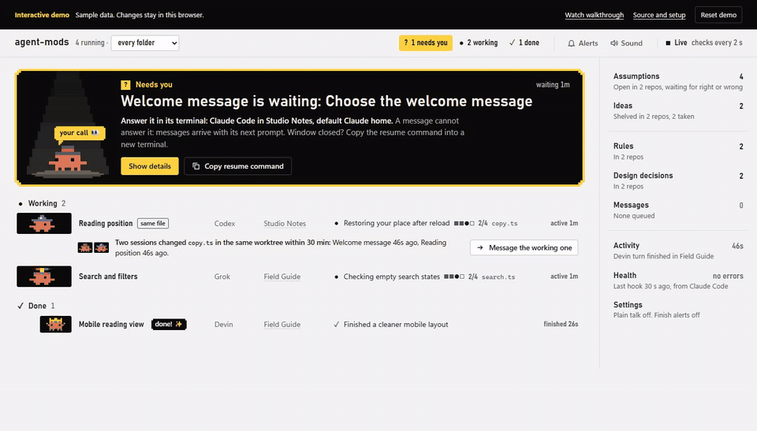
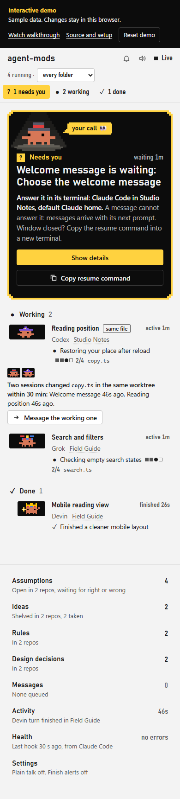
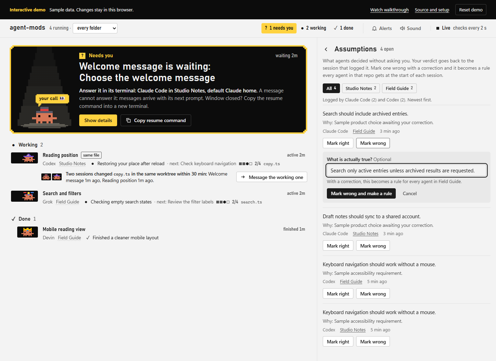

# agent-mods

Shared session tracking, assumptions, ideas, design choices and a local dashboard for Claude Code, Codex, Grok and Devin.

Node.js 22 or newer. Zero runtime dependencies. Each computer keeps its own agent logins and local data.

[Try the live interactive demo](https://naimkatiman.github.io/agent-mods/) | [Watch the short walkthrough](https://naimkatiman.github.io/agent-mods/walkthrough.html)

The hosted demo uses fictional projects and sample sessions. Try ideas, assumption corrections and settings;
changes stay in your browser, and Reset demo restores the sample. Install the local app to connect your own agents.


[](https://naimkatiman.github.io/agent-mods/walkthrough.html)

<details>
<summary>Mobile and assumption-review screenshots</summary>





</details>

Build the demo locally with `node demo/build.mjs` and serve `.demo-site/` using a static HTTP server.
The builder copies an explicit public asset list. It never reads agent homes or the local runtime store.

## Install on another PC

Use the GitHub Use this template button for your own repository, or clone directly.

```powershell
git clone https://github.com/naimkatiman/agent-mods.git C:\Tools\agent-mods
Set-Location C:\Tools\agent-mods
node -v
node .\bin\agent-mods.mjs install --dry-run
node .\bin\agent-mods.mjs install
```

Install and open your agents first so their configuration homes exist. Use a permanent checkout path without spaces.
Restart agents, run `node .\bin\agent-mods.mjs trust-codex` for Codex, start a prompt in each installed agent, then run `node .\bin\agent-mods.mjs doctor --deep`.
See [complete setup instructions](docs/SETUP.md) for PATH, partial installations, custom homes and updates. No `npm install` is required.

## Local dashboard

```powershell
node .\bin\agent-mods.mjs dashboard
node .\bin\agent-mods.mjs dashboard status
node .\bin\agent-mods.mjs dashboard stop
```

Open the printed localhost link including `?t=...`. Each PC runs its own copy and keeps data in `%USERPROFILE%\.agent-mods`.
The dashboard is not hosted on GitHub. Keep its token link private.

## Features

| Feature | Command |
| --- | --- |
| Sessions in this project | `agent-mods tracker` |
| Sessions across projects and agents | `agent-mods monitor` |
| Review assumptions | `agent-mods assumptions` |
| Shelf for ideas | `agent-mods idea` |
| Remember design choices | `agent-mods design` |
| Answer style preferences | `agent-mods plain` |
| Prompt enhancement | `enhance` skill |
| Terminal pets | `agent-mods clawd watch` |

The installer registers hooks, MCP tools, skills and CLI shims for discovered agent homes. It does not install agents or transfer logins.
Project data is scoped automatically by repository.

## Development

```powershell
npm test
```

Tests use isolated temporary stores and fake agent homes. The executable source is in `bin/` and `lib/`; installed skills are in `skills/`.
Reference-only claude-mods vendor sources and historical host plans are excluded. Original-source parity checks skip when those reference files are absent; runtime behavior tests remain enabled.

See [the mod contract](docs/CONTRACT.md) and [publication plan](docs/plans/2026-10-17-portable-repositories.md).
